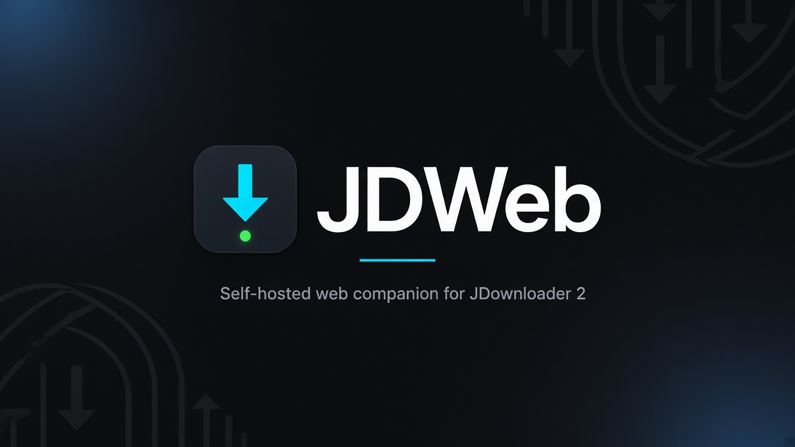
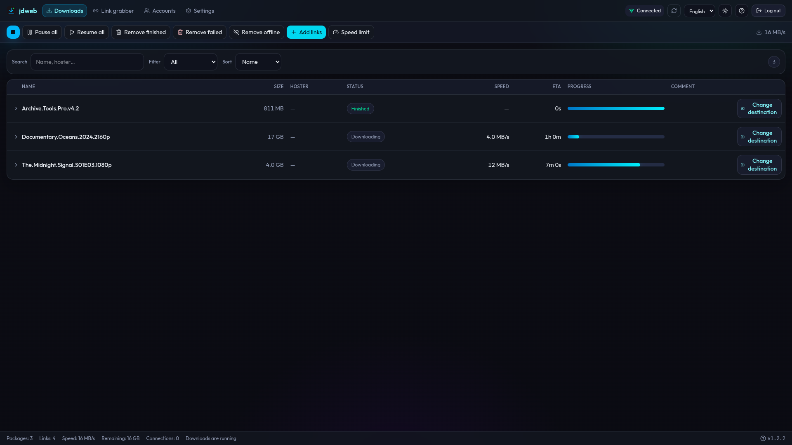
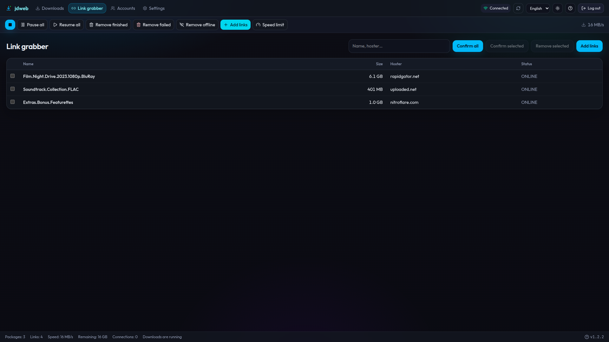
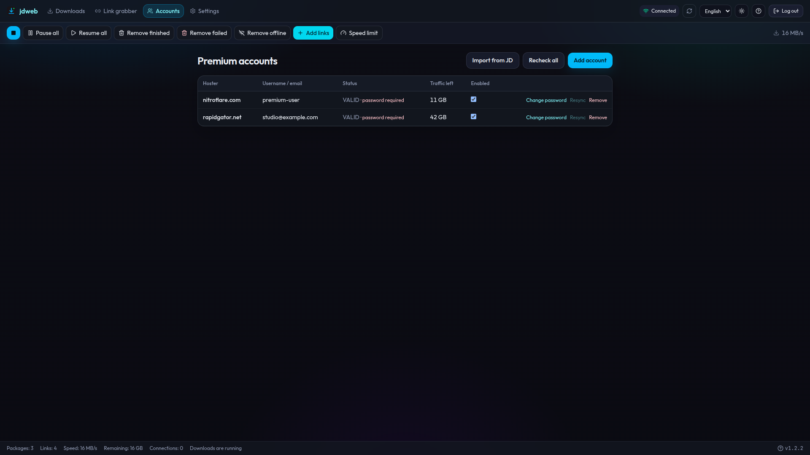
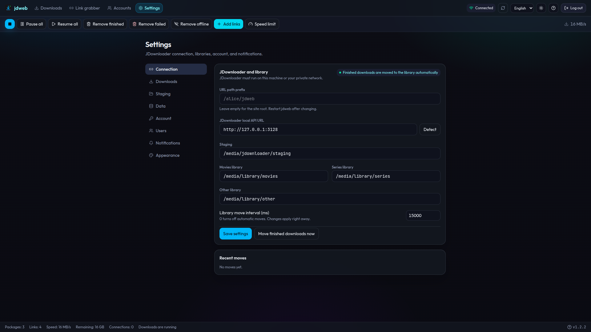

<p align="center">
  
</p>

<h1 align="center">JDWeb2</h1>

<p align="center">
  <strong>A modern web UI for JDownloader 2.</strong><br />
  Manage downloads, the link grabber, premium accounts, and your media library<br />
  from any browser — without exposing JDownloader’s local API.
</p>

<p align="center">
  <a href="https://github.com/krate-apps/jdweb/actions/workflows/ci.yml"></a>
  <a href="https://github.com/krate-apps/jdweb/releases"></a>
  <a href="https://github.com/krate-apps/jdweb/pkgs/container/jdweb"></a>
  <a href="LICENSE"></a>
</p>

<p align="center">
  <a href="#features">Features</a> ·
  <a href="#why-jdweb2">Why JDWeb2</a> ·
  <a href="#installation">Installation</a> ·
  <a href="#documentation">Documentation</a> ·
  <a href="https://github.com/krate-apps/jdweb/wiki">Wiki</a> ·
  <a href="https://github.com/krate-apps/jdweb/releases">Releases</a>
</p>

---

<p align="center">
  
</p>

<p align="center">
  
  &nbsp;
  
  &nbsp;
  
</p>

## Features

<table>
<tr>
<td width="50%" valign="top">

**↓ Downloads at a glance**  
Live package list with search, filters, sort, speed, ETA, and progress — plus pause, resume, and cleanup actions.

**⧉ Link grabber**  
Add URLs or `.dlc` / `.ccf` / `.rsdf` containers, watch crawler progress, then confirm into downloads.

**☰ Premium accounts**  
Store hoster credentials encrypted in SQLite, import from JDownloader, and keep them in sync.

</td>
<td width="50%" valign="top">

**▤ Library mover**  
Stage finished downloads, then move them automatically into Movies, Series, or Other library roots.

**⌁ Sessions & multi-user**  
Argon2id accounts, HTTP-only session cookies, and a first-run setup wizard (or localhost setup API).

**◐ Dark & light, EN & FR**  
Theme and language preferences stay on the device. Optional webhooks and completion toasts when jobs finish.

</td>
</tr>
</table>

## Why JDWeb2

JDownloader’s local API stays on your machine. JDWeb2 is the only thing the browser reaches — so you get a proper web UI, sign-in, and library automation without opening JD to the network.

- **Private by default** — no MyJDownloader dependency; the UI never calls JD directly
- **Your data, your disk** — users, sessions, and encrypted hoster secrets live in SQLite next to the app
- **Fits a reverse proxy** — mount it under `/jdweb` (or any prefix) with Docker or a native install

## Installation

Pick the path that fits your setup. Both need a running [JDownloader 2](https://jdownloader.org/) instance with the **local HTTP API** enabled.

### Docker

```bash
docker compose up -d
# → http://127.0.0.1:8787
```

Images publish to GHCR as `ghcr.io/krate-apps/jdweb` — tags <!-- jdweb-version -->1.2.2<!-- /jdweb-version --> and `:latest`. Mount `./data` for the database, secrets, staging, and library paths. Optional path prefix without rebuild:

```bash
JDWEB2_BASE_PATH=/jdweb docker compose up -d
```

### Native

Needs Node.js and pnpm (pins in `package.json`).

```bash
pnpm install && pnpm build && pnpm start
# → http://127.0.0.1:8787
```

On first boot, secrets are written to `data/secrets.env` if missing. Open the UI on **localhost** and finish the setup wizard (admin, JD URL, library paths), or create the admin via API:

```bash
curl -sS -X POST http://127.0.0.1:8787/api/setup/admin \
  -H 'Content-Type: application/json' \
  -d '{"username":"admin","password":"password123"}'
```

## Documentation

| Topic           | Guides                                                                                                                                     |
| --------------- | ------------------------------------------------------------------------------------------------------------------------------------------ |
| **Get started** | [Installation](docs/Installation.md) · [Configuration](docs/Configuration.md) · [Running](docs/Running.md)                                 |
| **Secure it**   | [Reverse proxy](docs/Reverse-proxy.md) · [Authentication](docs/Authentication.md)                                                          |
| **Day-to-day**  | [Destinations & mover](docs/Destinations-and-library-mover.md) · [Webhooks](docs/Webhooks.md) · [Troubleshooting](docs/Troubleshooting.md) |
| **Reference**   | [API](docs/API.md) · [Releases](docs/Release.md) · [Wiki](https://github.com/krate-apps/jdweb/wiki)                                        |

## Disclaimer

JDWeb2 is an independent, unofficial, third-party project. It is **not** affiliated with, endorsed by, sponsored by, or associated with JDownloader, AppWork GmbH, or any of their owners, partners, or licensors. “JDownloader”, “MyJDownloader”, and related names and logos are trademarks or registered trademarks of their respective owners. JDWeb2 claims **no** rights in those marks, in JDownloader’s software, APIs, branding, or documentation, and does not claim to be an official product or extension of JDownloader. Use of JDownloader remains subject solely to its own terms and licenses; JDWeb2 merely interacts with a locally available HTTP API that you enable yourself.

---

<p align="center">
  Released under the <a href="LICENSE">MIT License</a>.<br />
</p>
